

**Mahalladagi 17 lavozim xodimining yagona ish platformasi:** fuqaro murojaati, uyma-uy tashrif, ish daftarlari va hokimlik me'yorlari bitta tizimda. Hisobga faqat dalil bilan tasdiqlangan fakt kiradi, tuman va viloyat esa hammasini situatsion markazda ko'radi.

---

## Situatsion markaz

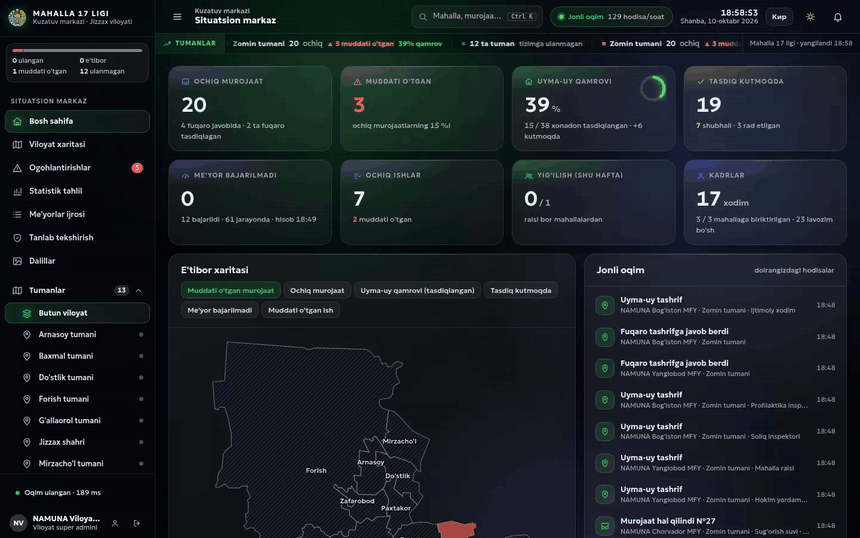

Mahalla jamoasi 17 lavozimdan iborat va **hammasi teng**: har biri o'z vazifalari, ish daftarlari va me'yorlari bilan tizimda bor. Ish uch tomonda ketadi:

| Kim | Nima qiladi |
|---|---|
| 🙋 **Fuqaro** | QR yoki havola orqali murojaat yuboradi, ish yakunini o'zi tasdiqlaydi |
| 🧑‍💼 **Xodim** | Telefondan uyma-uy tashrif, daftar yozuvi va murojaat ijrosini kiritadi, dalil (rasm, video, hujjat) qo'shadi |
| 🏛️ **Rahbar** | Mahalla raisi faktlarni tasdiqlaydi, tuman va viloyat situatsion markazda kuzatadi |

## Asosiy imkoniyatlar

| | |
|---|---|
| 📨 **Murojaat yo'li** | 18 ta yo'nalish, har biri mas'ul lavozimga avtomatik boradi. Muddat: shoshilinch 3, muhim 7, oddiy 15 ish kuni. Holatlar zanjiri: yangi → jarayonda → eskalatsiya → fuqaro tasdig'i → yopildi. Murojaat fuqaro tasdiqlagandan keyingina yopiladi |
| 📋 **Me'yorlar** | 91 ta me'yor: 49 tasi hokimlikning majburiy me'yori, 42 tasi qo'shimcha. Bundan tashqari qonundagi 139 ta vazifa. Me'yor ijrosi mahalla va lavozim kesimida ko'rinadi, Excel'ga chiqariladi |
| ✅ **Dalil va tasdiq** | Hisobga faqat tasdiqlangan fakt kiradi. Shubha belgilari avtomatik qo'yiladi: joylashuvsiz, takroriy rasm, oflayn yozilgan, oldingi tashrifdan bir necha daqiqa o'tmay yozilgan. Belgi ayb emas, tekshirish uchun e'tibor |
| 🎲 **Tanlab tekshirish** | Har oy tasdiqlangan faktlarning ~5 foizi tasodifiy tanlanadi va joyida qayta tekshiriladi |
| 🖼️ **Media** | Rasm brauzerda 1600 px ga kichraytiriladi, video 40 MB gacha. Fayl turi nomidan emas, baytlaridan aniqlanadi. Dalil o'chirilmaydi: faqat yuklagan xodim 15 daqiqa ichida qaytarib oladi, bu ham auditga yoziladi |
| 🗺️ **Situatsion markaz** | Jonli oqim (SSE), e'tibor xaritasi, ogohlantirishlar, statistik tahlil, dalillar galereyasi. Xarita rangi «qayerga e'tibor kerak»ligini ko'rsatadi, reyting emas |
| 🗓️ **Ish kalendari va hisobot** | Muddatlar, tadbirlar va me'yor davrlari bitta kalendarda. Oylik mahalla hisoboti tizimdagi yozuvlardan o'zi yig'iladi, xodim qog'oz hisobot yozmaydi |
| 📱 **Telefon uchun** | PWA: internet yo'qligida ham yozish mumkin, aloqa tiklanganda yuboriladi. Lotin va kirill yozuvi, kunduzgi va tungi mavzu |
| 🔐 **Xavfsizlik** | Kirish parol va Telegram kodi bilan. Admin bergan bir martalik parol birinchi kirishda almashtiriladi. JShShIR va pasport saqlanmaydi, maxfiy daftardagi F.I.O. faqat egasiga va koordinatorga ko'rinadi. 6 ta rol, huquqlar sukut bo'yicha yopiq |

## Ekranlar

<table>
<tr>
<td width="50%">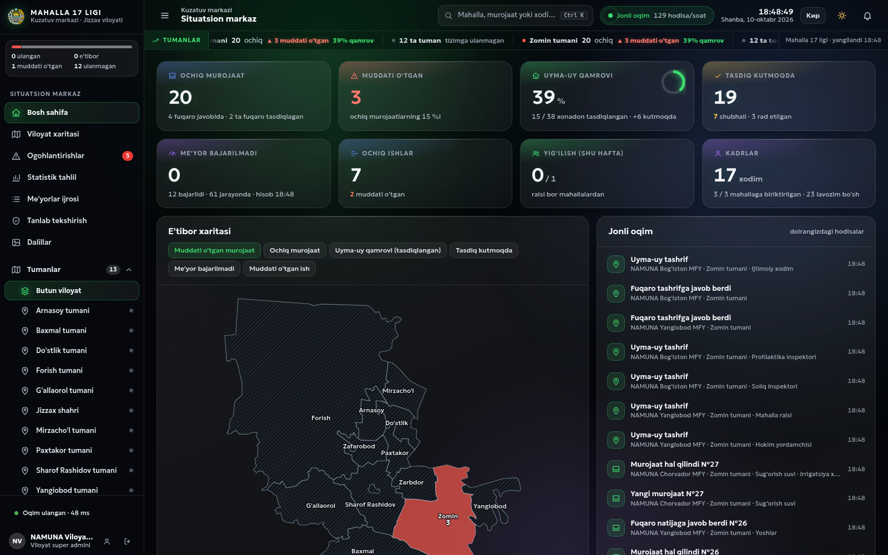 <b>Situatsion markaz</b> — 8 ko'rsatkich, e'tibor xaritasi, jonli oqim</td>
<td width="50%">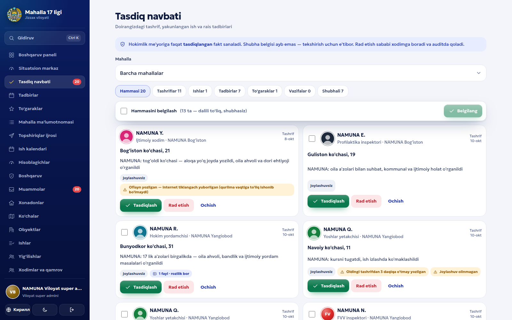 <b>Tasdiq navbati</b> — shubha belgilari bilan, ommaviy tasdiq</td>
</tr>
<tr>
<td>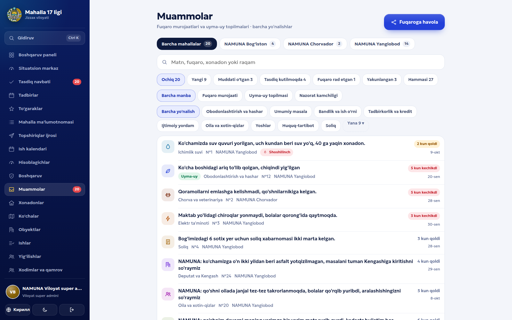 <b>Muammolar</b> — fuqaro murojaati va uyma-uy topilmalari, muddat bilan</td>
<td>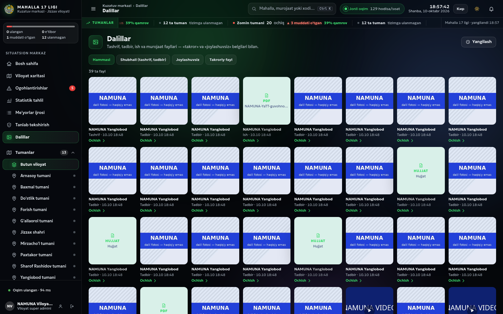 <b>Dalillar</b> — tashrif, tadbir va ish fayllari galereyasi</td>
</tr>
<tr>
<td>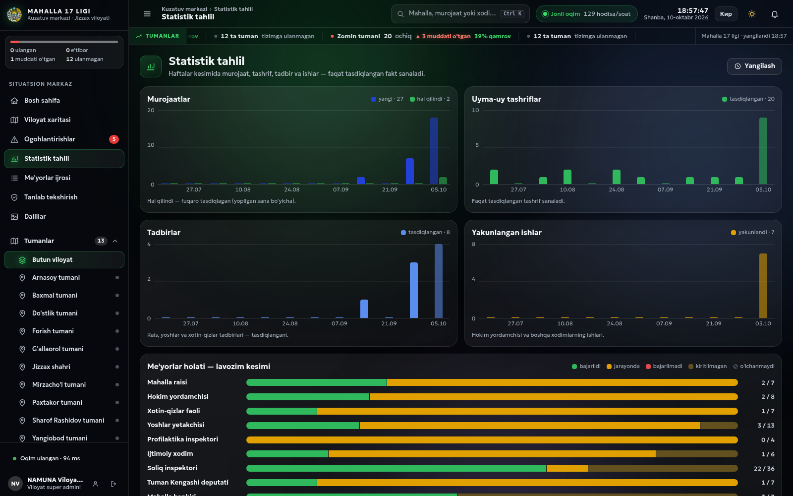 <b>Statistik tahlil</b> — haftalar kesimi va lavozimlar bo'yicha me'yor holati</td>
<td>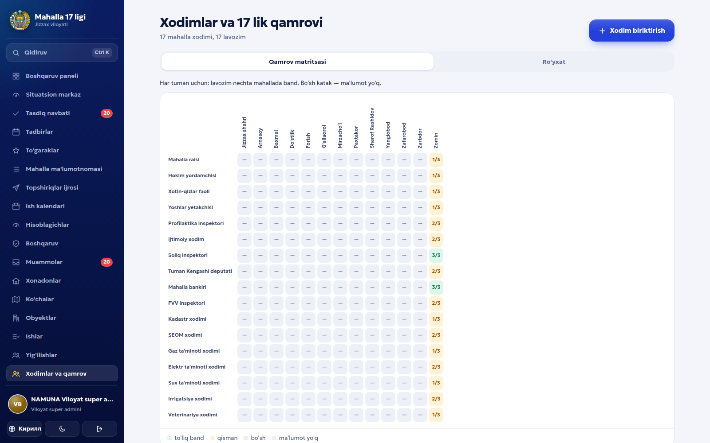 <b>17 lik qamrovi</b> — qaysi mahallada qaysi lavozim bo'sh</td>
</tr>
<tr>
<td>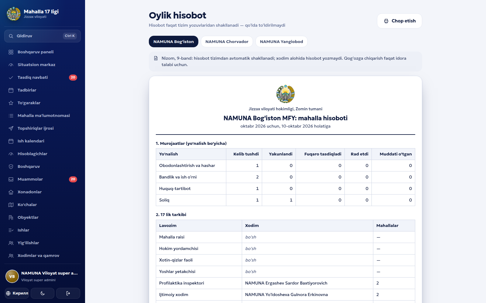 <b>Oylik hisobot</b> — tizim yozuvlaridan avtomatik, chop etishga tayyor</td>
<td>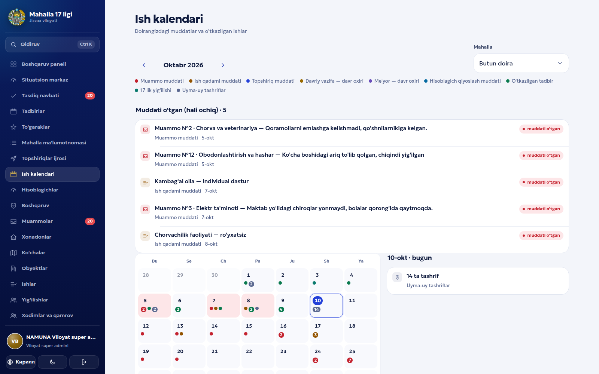 <b>Ish kalendari</b> — muddati o'tganlar va oy rejasi</td>
</tr>
<tr>
<td colspan="2">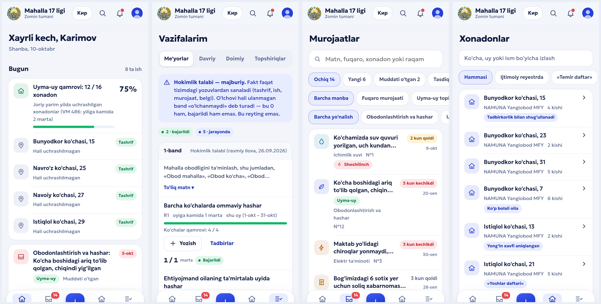 <b>Xodim telefoni</b> — bugungi ishlar, me'yorlar, murojaatlar, xonadonlar</td>
</tr>
<tr>
<td colspan="2">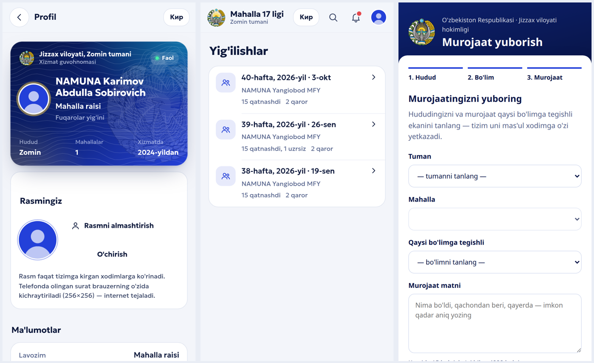 <b>Xizmat guvohnomasi, yig'ilishlar va fuqaro sahifasi</b> — murojaat uch qadamda yuboriladi</td>
</tr>
</table>

> Suratlardagi barcha mahallalar, xodimlar, xonadonlar va murojaatlar **namuna ma'lumot** («NAMUNA» belgisi bilan). Telefon raqamlari soxta, rasm-dalillar sxematik.

## Arxitektura

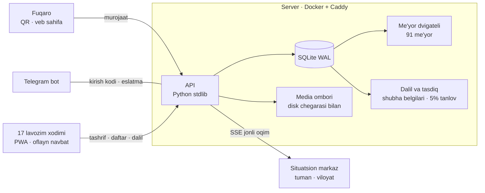

- **Tashqi kutubxonasiz:** server Python standart kutubxonasida, front build'siz va CDN'siz vanilla JavaScript.
- **Bitta konfiguratsiya:** 17 lavozim, murojaat yo'nalishlari, muddatlar va ish daftarlari bitta faylda ta'riflangan, ekranlar shundan quriladi.
- **Namuna rejimi:** namuna ma'lumot alohida belgi bilan yaratiladi va bitta buyruq bilan to'liq o'chiriladi (oldin zaxira olinadi). Namuna hisob faqat namuna faktlarni ko'radi.

## Sifat

**731 ta avtomatik sinov, 0 xato** (toza vaqtinchalik bazada ishga tushirib sanaldi). Qamrovi: rollar va huquqlar, murojaat zanjiri va muddatlar, me'yor hisobi, dalil va tasdiq qoidalari, media cheklovlari, maxfiy ma'lumot ko'rinishi, namunani tozalash, zaxira.

## Texnologiyalar

Python 3 (stdlib) · SQLite (WAL) · vanilla JavaScript · PWA + Service Worker · Server-Sent Events · SVG xarita · Telegram Bot API · Docker + Caddy

## Jonli

🌐 [17lik.geonazorat.uz](https://17lik.geonazorat.uz) — xodimlar kirishi (hisoblar tuman admini tomonidan beriladi)

---

**Manba kodi yopiq.** Namoyish yoki hamkorlik bo'yicha: Telegram [@Humoyun_Davronov](https://t.me/Humoyun_Davronov)

Muallif — Humoyun Davronov

